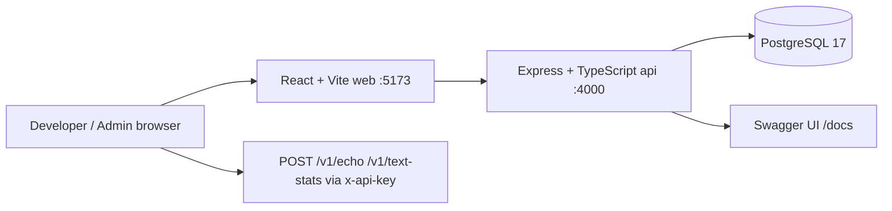

# DevOnboard

Guided onboarding to a first successful API call, a usage dashboard, and a built-in A/B experiment on the onboarding flow with funnel analytics.

> **Synthetic data:** the seed generates ~500 synthetic users and synthetic funnel events. No real users. A "Synthetic data" badge is shown in the UI.

## Problem
Developers sign up for an API and abandon before their first successful call. Small API teams cannot see where developers drop off, or test whether a better onboarding flow improves activation.

## Research basis
API usability research shows learning barriers hurt API adoption (Myers & Stylos 2016; Robillard 2009). Industry tracks "time to first successful call" as an activation metric. Gap addressed: most dashboards show usage *after* adoption, not the pre-activation funnel, and give no experiment tooling.

## Architecture


## Setup — 3 commands
```bash
cp .env.example .env
docker compose up --build
open http://localhost:5173
```
API runs the seed on first boot (`prisma migrate deploy && prisma db seed`). Docs at `http://localhost:4000/docs`.

Local dev (without Docker): start Postgres 17, set `DATABASE_URL` in `api/.env`, then `cd api && npm ci && npx prisma migrate dev && npm run seed && npm run dev` and `cd web && npm ci && npm run dev`.

## Design decisions
- Keys: only SHA-256 hash stored; full key shown once at creation, list shows prefix only.
- Auth: bcrypt passwords, JWT in httpOnly cookie, roles `DEVELOPER`/`ADMIN`.
- Variant: deterministic `SHA-256(userId) % 2` → A/B, so a user always sees the same variant.
- Gateway: `x-api-key` check, 60 req/min per key (in-memory window), every call logged with status + latency.
- Funnel: events `signup, key_created, snippet_copied, first_call_success`; admin compares variants with a two-proportion z-test and median time-to-first-call.
- Error shape everywhere: `{ error: { code, message } }`. List endpoints paginate with `?page&limit`.

## Pinned versions (supported, Nov 2026)
Node 24 LTS (to 2028-04-30), PostgreSQL 17 (to 2029-11-08), React 19, Vite 7, TypeScript 5.9, Express 5.1, Prisma 6, Recharts 3, Vitest 4, Playwright 1.55.

## Limitations
- In-memory rate limiting does not share state across API replicas.
- No email, OAuth, teams, payments, notifications, or admin user management (out of scope).
- Seed data is synthetic; funnel results from it are illustrative, not evidence about real developers.
- Tests were not run in the delivery environment (no Docker/Postgres there). Run them with the commands below and report the output.

## How to measure
```bash
docker compose up --build
cd api && npm run test        # Vitest unit + Supertest API
cd web && npx playwright test # 1 e2e onboarding test (needs api+web up)
curl -s http://localhost:4000/api/admin/funnel -b cookies.txt | python3 -m json.tool
```
Do not quote a number you did not measure. Use `[FILL IN]` in resumes until you have run these commands.
