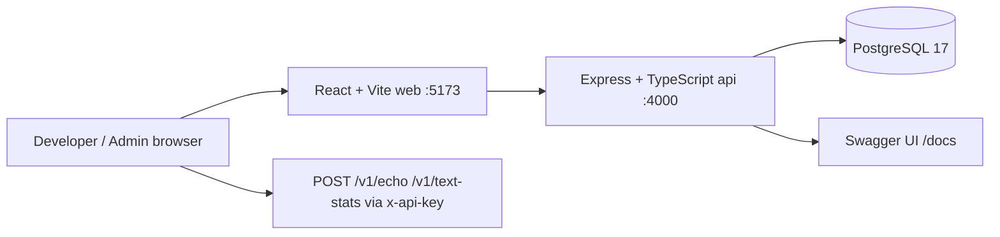

# DevOnboard

Guided onboarding to a first successful API call, a usage dashboard, and a built-in A/B experiment on the onboarding flow with funnel analytics.

> **Synthetic data:** the seed generates ~500 synthetic users and synthetic funnel events. No real users. A "Synthetic data" badge is shown in the UI. The seed uses the *same* conversion probabilities for variants A and B, so it does not pre-decide a winner — and the z-test on synthetic data is a demo only, not evidence about real developers.

## Problem
Developers sign up for an API and abandon before their first successful call. Small API teams cannot see where developers drop off, or test whether a better onboarding flow improves activation.

## Research basis
API usability research shows learning barriers hurt API adoption (Myers & Stylos 2016; Robillard 2009). Industry tracks "time to first successful call" as an activation metric. Gap addressed: most dashboards show usage *after* adoption, not the pre-activation funnel, and give no experiment tooling.

## Architecture


## Setup — exactly 3 commands
```bash
cp .env.example .env
docker compose up --build
open http://localhost:5173
```
The API runs `prisma migrate deploy`, then the seed, then starts. Docs at `http://localhost:4000/docs`.

Local dev (without Docker): start Postgres 17, set `DATABASE_URL` in `api/.env`, then `cd api && npm ci && npx prisma migrate dev && npm run seed && npm run dev` and `cd web && npm ci && npm run dev`.

## Design decisions
- Keys: only SHA-256 hash stored; full key shown once at creation, list shows prefix only.
- Auth: bcrypt passwords, JWT in httpOnly cookie, roles `DEVELOPER`/`ADMIN`.
- Variant: deterministic `SHA-256(userId) % 2` → A/B, so a user always sees the same variant. Variant A shows one onboarding step at a time (key → snippet → test call, with Next); variant B shows everything on one page with a live "Try it" panel. Both use the same API and record the same events.
- Gateway: `x-api-key` check, 60 req/min per key (in-memory window). Every call attributable to a real key is logged with status and latency — including 401s for revoked keys and 429s. Calls with a missing or unknown key have no key id and cannot be logged against a key, so they are not logged.
- Funnel: events `signup, key_created, snippet_copied, first_call_success`; admin compares variants with a two-proportion z-test and median time-to-first-call.
- Error shape everywhere: `{ error: { code, message } }`. List endpoints paginate with `?page&limit`.

## Security notes (fixes, 2026-11-19)
- Signup always creates `DEVELOPER`. The `role` field is not accepted from the client at all; only the seed script creates the ADMIN. Sending `role: "ADMIN"` in a signup body still yields `DEVELOPER`, and that user gets 403 on `/api/admin/funnel`.
- The API throws at startup if `JWT_SECRET` is missing when `NODE_ENV=production`. The dev fallback applies only outside production. Docker Compose runs the API with `NODE_ENV=production`; set a real `JWT_SECRET` in `.env` (see `.env.example`).
- `first_call_success` cannot be spoofed from the client: `POST /api/events` rejects it (400), and the web app never sends it. Only the gateway creates it, after a real successful sandbox call, exactly once per user.
- Seed admin credentials `admin@devonboard.test / Password123!` are for **local demo only — do not deploy** with them. Change or remove the seeded admin before any real deployment.

## Seed
- Idempotent: the seed returns early if any users already exist, so restarting the stack never wipes data. To wipe and reseed on purpose: `cd api && npm run seed:reset`.
- Synthetic, equal probabilities for A and B (see the banner at the top).

## Pinned versions (supported, Nov 2026)
Node 24 LTS (to 2028-04-30), PostgreSQL 17 (to 2029-11-08), React 19, Vite 7, TypeScript 5.9, Express 5.1, Prisma 6, Recharts 3, Vitest 4, Playwright 1.55.

## Known limitations
- In-memory rate limiting does not share state across API replicas.
- Demo credentials: the seeded admin (`admin@devonboard.test / Password123!`) is demo-only and must not be deployed.
- Synthetic data: the seed is synthetic with equal A/B probabilities; the funnel z-test on it is a demo only.
- No email, OAuth, teams, payments, notifications, or admin user management (out of scope).
- Local note: the stock npm 10.9.4 bundled with Node 24 crashes (`Cannot read properties of null (reading 'edgesOut')`) resolving Vitest 4's peer tree; use npm 12 (`node /usr/lib/node_modules/npm/bin/npm-cli.js install`) or upgrade npm if you hit it. In this VM, Prisma's own engine downloader is reset by the egress proxy — engines were fetched with curl instead (see `api/prisma/migrations` note in the repo history); on a normal machine and in CI, `prisma generate` downloads them directly.

## How to measure
```bash
docker compose up --build
curl -s localhost:4000/health
cd api && npm ci && npm run lint && npm test   # Vitest unit + Supertest API, with coverage
cd web && npm ci && npm run build && npx playwright test   # in web/, 1 e2e onboarding test
curl -s http://localhost:4000/api/admin/funnel -b cookies.txt | python3 -m json.tool
```
API tests run against `DATABASE_URL` from the environment (default: a local `devonboard_test` database); migrations run once in `api/tests/globalSetup.ts`, and test users are cleaned up after the run. Do not quote a number you did not measure.
